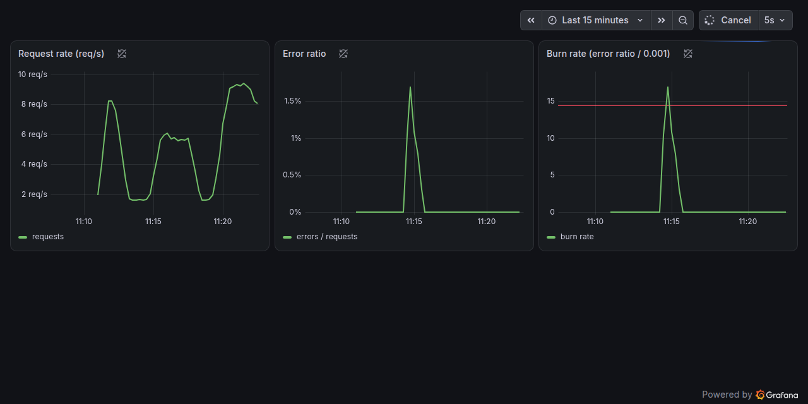
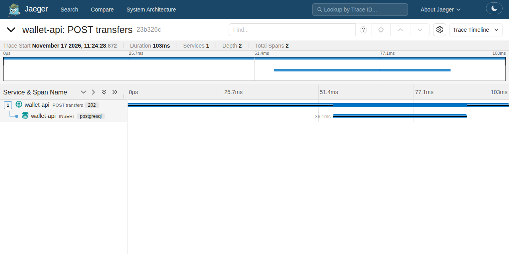

# Lab 7.2 · Observing the Wallet

## Goal

Make the wallet answer three questions: is it broken now, where is the time going, and what exactly did it do. You scrape its metrics with Prometheus, break the database on purpose and read what the alerts do, draw a dashboard from a file in git, and follow one request across the API and the database as a trace in Jaeger.

{{diagram lab-7-2-01.jsx | what you will build · Lab 7.2}}

Read it from the left: the load generator calls the API; Prometheus pulls its numbers, Grafana draws what Prometheus holds, and the API pushes its spans to Jaeger.

**Versions tested.** Kubernetes 1.37.0 on kind v0.33.0, kubectl 1.37.1, Helm v4.3.1, Prometheus chart `prometheus-community/prometheus` 29.47.2 (Prometheus v3.16.0, with its bundled kube-state-metrics), Grafana 13.3.1, Jaeger 2.23.0, Postgres 17. The instrumented wallet adds `opentelemetry-sdk` 1.45.2, `opentelemetry-exporter-otlp-proto-http` 1.45.2 and `opentelemetry-instrumentation-psycopg` 0.66b2 on Python 3.12. Test machine: Ubuntu 26.04 on WSL2 with Docker Desktop; images were loaded with `docker save` and `kind load image-archive`. Not run: Alertmanager, Fluent Bit, Thanos (Ch 7.2 describes them), Ubuntu 24.04 itself.

**Lab only.** Grafana runs with anonymous admin access and Prometheus without persistent storage. Fine on a laptop, wrong anywhere else.

## Setup

You need the `~/wallet-gitops` repository from Lab 7.1 (its dev overlay), the wallet image, and a fresh cluster. This lab builds a second image, `wallet:v1-otel`, in Part E; load it later.

```bash
export KUBECONFIG=$PWD/kubeconfig
kind create cluster --name cnlab --image kindest/node:v1.37.0
docker save wallet:v1 -o wallet-v1.tar && kind load image-archive wallet-v1.tar --name cnlab
kubectl create namespace wallet
kubectl apply -k ~/wallet-gitops/kustomize/overlays/dev -n wallet
```

Save this as `loadgen.yaml`. It creates two accounts and then posts one transfer every 0.1 second plus the time `curl` takes, which gave about 8 requests per second in total on the test machine, counting the Pods' health probes.

```yaml
apiVersion: v1
kind: Pod
metadata: {name: loadgen, namespace: wallet}
spec:
  containers:
  - name: loadgen
    image: curlimages/curl:8.15.0
    command: ["sh", "-c"]
    args:
    - |
      curl -s -X POST wallet-api/accounts -d '{"name":"alice","balance":1000000}' >/dev/null
      curl -s -X POST wallet-api/accounts -d '{"name":"bob","balance":1000}' >/dev/null
      i=0
      while true; do
        i=$((i+1))
        curl -s -o /dev/null -X POST wallet-api/transfers -d "{\"id\":\"load-$(date +%s)-$i\",\"from\":\"alice\",\"to\":\"bob\",\"amount\":1}"
        sleep 0.1
      done
    resources: {requests: {cpu: 10m, memory: 16Mi}, limits: {memory: 64Mi}}
```

```bash
kubectl apply -f loadgen.yaml
kubectl -n wallet get pods
```

## Part A · Prometheus scrapes the wallet

The wallet's Pods already carry the three annotations `prometheus.io/scrape`, `prometheus.io/port` and `prometheus.io/path` (they are in the base from Lab 7.1). The Prometheus chart's built-in `kubernetes-pods` job scrapes every Pod that has them. Save the values file below as `prom-values.yaml`. It turns off what the lab does not need, scrapes every 5 seconds, and defines two alert rules; read the rules now, you will provoke them in Part C.

```yaml
# prom-values.yaml - a small Prometheus (8 GB laptop)
alertmanager: {enabled: false}
kube-state-metrics: {enabled: true}      # needed for the WalletDown alert: it reports Deployment replica counts
prometheus-node-exporter: {enabled: false}
prometheus-pushgateway: {enabled: false}
server:
  persistentVolume: {enabled: false}
  retention: 6h
  global:
    scrape_interval: 5s
    scrape_timeout: 4s              # must not exceed the interval, or Prometheus refuses to start
    evaluation_interval: 5s
serverFiles:
  alerting_rules.yml:
    groups:
    - name: wallet-slo
      rules:
      - alert: WalletFastBurn
        # error ratio over 1 minute above 14.4 x the 0.1 % budget rate (SLO 99.9 %); production pairs two windows
        expr: |
          sum(rate(wallet_api_errors_total[1m])) / sum(rate(wallet_api_requests_total[1m])) > 14.4 * 0.001
        for: 30s
        labels: {severity: page}
        annotations: {summary: "wallet API is burning its error budget 14.4x too fast"}
      - alert: WalletDown
        # no ready wallet-api Pod: requests are refused before they reach the app, so no error is counted
        expr: kube_deployment_status_replicas_available{namespace="wallet", deployment="wallet-api"} == 0
        for: 30s
        labels: {severity: page}
        annotations: {summary: "no wallet-api Pod is ready"}
```

```bash
helm repo add prometheus-community https://prometheus-community.github.io/helm-charts
helm install prometheus prometheus-community/prometheus --version 29.47.2 -n monitoring --create-namespace -f prom-values.yaml
kubectl -n monitoring rollout status deployment/prometheus-server
kubectl -n monitoring port-forward svc/prometheus-server 9090:80 &
```

`kubectl -n monitoring get pods` should show `prometheus-server` with `2/2` and `prometheus-kube-state-metrics` with `1/1`. (If you leave out `scrape_timeout`, the server Pod goes into `CrashLoopBackOff` and its log says `global scrape timeout greater than scrape interval`. That happened on the first try on the test machine.)

Ask Prometheus which targets it found, then run the three queries from the theory. The `curl` call is the same HTTP API the Prometheus web page uses.

```bash
curl -s localhost:9090/api/v1/targets | python3 -c "
import json,sys
for t in json.load(sys.stdin)['data']['activeTargets']:
    if t['labels']['job']=='kubernetes-pods' and t['labels'].get('namespace')=='wallet': print(t['labels']['job'], t['labels']['pod'], t['health'])"
q() { curl -s -G localhost:9090/api/v1/query --data-urlencode "query=$1"; echo; }
q 'sum(rate(wallet_api_requests_total[1m]))'
q 'wallet_api_requests_total'
q 'sum(rate(wallet_api_errors_total[1m])) / sum(rate(wallet_api_requests_total[1m]))'
q 'sum(increase(wallet_api_transfers_requested_total[10m]))'
```

```text
kubernetes-pods wallet-api-6dbd75f46c-8mx49 up
kubernetes-pods wallet-api-6dbd75f46c-ndpp5 up
{... "value":[1794888698.536,"7.262215233873357"]}                 <- requests per second, all Pods
{... "pod":"wallet-api-6dbd75f46c-ndpp5" ... "value":[...,"1232"]},   <- the raw counter: one series per Pod,
{... "pod":"wallet-api-6dbd75f46c-8mx49" ... "value":[...,"1346"]}     <- plus labels job, instance, namespace, pod
{... "value":[1794888698.603,"0"]}                                    <- error ratio: 0
{... "value":[1794888698.641,"353.2733040477158"]}                   <- transfers in 10 min (extrapolated, so not a whole number)
```

Two things to notice. The raw counter has one series per Pod, which is why every query used `sum`. And `increase` returned a fraction: Prometheus extrapolates to the window edges, so treat it as an estimate.

## Part B · Take the database away

A dashboard that only ever shows green teaches nothing. Stop the database, write down the time, and watch what each signal does. Open the Prometheus alerts page at `http://localhost:9090/alerts` while you wait.

```bash
date +%T; kubectl -n wallet scale statefulset wallet-postgres --replicas=0
kubectl -n wallet get pods -w            # watch the API Pods lose readiness
# after about 100 seconds:
date +%T; kubectl -n wallet scale statefulset wallet-postgres --replicas=1
```

The numbers below come from Prometheus, asked after the run with `query_range` at a 5-second step. Second 0 is the moment the database was stopped.

| Second | What happened | How you can see it |
| --- | --- | --- |
| 0 | `wallet-postgres` scaled to 0 | your command |
| 10 | both `wallet-api` Pods unready, so the Service has no endpoints | `kube_deployment_status_replicas_available` falls to 0 |
| 40 | `WalletDown` fires: 10 seconds to unready plus its 30-second `for:` | `/alerts` shows Firing |
| 101 | `wallet-postgres` scaled back to 1 | your command |
| 110 | both Pods ready again; `WalletDown` clears | `replicas_available` back to 2 |

{{diagram lab-7-2-02.jsx | Prometheus query_range, step 5 s · Lab 7.2 run on kind 1.37, 2026-11-17 · data: data/vol7-outage-alerts-2026-11-17.csv}}

Read the chart before you read the explanation. The request rate fell from about 5.7 to 1.6 requests per second, so users were clearly hurt, and the error ratio stayed at exactly 0 % in every sample. The `WalletFastBurn` alert, which watches the error ratio, never even reached pending. Only the alert that looks at Pod readiness fired.

The cause is in the order of events. Within seconds the API Pods became unready (their `/readyz` probe needs the database), so the Service had no endpoints and refused connections: the requests never reached the application, and the application can only count what it sees. The few requests that did arrive, the health probes, hang for up to 30 seconds while the wallet retries the database connection, so they fail only after the outage is over. In an earlier run with a longer outage (121 seconds) the error ratio did rise, to a peak of 2.04 %, about 14 seconds after the database came back, which is too late to page anyone. This is the blind spot the theory warned about: an SLI computed from the application's own counters misses the failures that happen before the application. Measure as close to the user as you can, and keep an alert like `WalletDown` that does not depend on the application noticing.

## Part C · A dashboard that lives in git

A dashboard clicked together in a browser is lost with the Pod. A dashboard provisioned from a file is reviewed, versioned and restored like code. Save the dashboard below as `wallet-slo.json` and the Deployment as `grafana.yaml`. The three panels are the three numbers of Ch 7.2: request rate, error ratio and burn rate (error ratio divided by the 0.001 budget), with a threshold line at 14.4.

```json
{"uid": "wallet-slo", "title": "Wallet SLO", "schemaVersion": 39, "version": 1, "refresh": "5s", "time": {"from": "now-15m", "to": "now"}, "tags": ["wallet"], "panels": [
  {"id": 1, "type": "timeseries", "title": "Request rate (req/s)", "gridPos": {"x": 0, "y": 0, "w": 8, "h": 9}, "datasource": {"type": "prometheus", "uid": "prom"}, "targets": [{"refId": "A", "expr": "sum(rate(wallet_api_requests_total[1m]))", "legendFormat": "requests"}], "fieldConfig": {"defaults": {"unit": "reqps", "custom": {"lineWidth": 2}}, "overrides": []}},
  {"id": 2, "type": "timeseries", "title": "Error ratio", "gridPos": {"x": 8, "y": 0, "w": 8, "h": 9}, "datasource": {"type": "prometheus", "uid": "prom"}, "targets": [{"refId": "A", "expr": "sum(rate(wallet_api_errors_total[1m])) / sum(rate(wallet_api_requests_total[1m]))", "legendFormat": "errors / requests"}], "fieldConfig": {"defaults": {"unit": "percentunit", "custom": {"lineWidth": 2}}, "overrides": []}},
  {"id": 3, "type": "timeseries", "title": "Burn rate (error ratio / 0.001)", "gridPos": {"x": 16, "y": 0, "w": 8, "h": 9}, "datasource": {"type": "prometheus", "uid": "prom"}, "targets": [{"refId": "A", "expr": "sum(rate(wallet_api_errors_total[1m])) / sum(rate(wallet_api_requests_total[1m])) / 0.001", "legendFormat": "burn rate"}], "fieldConfig": {"defaults": {"unit": "none", "custom": {"lineWidth": 2, "thresholdsStyle": {"mode": "line"}}, "thresholds": {"mode": "absolute", "steps": [{"color": "green", "value": null}, {"color": "red", "value": 14.4}]}}, "overrides": []}}
]}
```

```yaml
# grafana.yaml
apiVersion: v1
kind: ConfigMap
metadata: {name: grafana-provisioning, namespace: monitoring}
data:
  datasource.yaml: |
    apiVersion: 1
    datasources:
    - {name: Prometheus, uid: prom, type: prometheus, access: proxy, url: "http://prometheus-server.monitoring.svc", isDefault: true}
  dashboards.yaml: |
    apiVersion: 1
    providers:
    - {name: wallet, type: file, options: {path: /var/lib/grafana/dashboards}}
---
apiVersion: apps/v1
kind: Deployment
metadata: {name: grafana, namespace: monitoring}
spec:
  replicas: 1
  selector: {matchLabels: {app: grafana}}
  template:
    metadata: {labels: {app: grafana}}
    spec:
      containers:
      - name: grafana
        image: grafana/grafana:13.3.1
        ports: [{containerPort: 3000}]
        env:
        - {name: GF_AUTH_ANONYMOUS_ENABLED, value: "true"}        # LAB ONLY: no login
        - {name: GF_AUTH_ANONYMOUS_ORG_ROLE, value: Admin}
        resources: {requests: {memory: 128Mi}, limits: {memory: 512Mi}}
        volumeMounts:
        - {name: provisioning-ds, mountPath: /etc/grafana/provisioning/datasources/datasource.yaml, subPath: datasource.yaml}
        - {name: provisioning-db, mountPath: /etc/grafana/provisioning/dashboards/dashboards.yaml, subPath: dashboards.yaml}
        - {name: dashboards, mountPath: /var/lib/grafana/dashboards}
      volumes:
      - {name: provisioning-ds, configMap: {name: grafana-provisioning}}
      - {name: provisioning-db, configMap: {name: grafana-provisioning}}
      - {name: dashboards, configMap: {name: grafana-dashboards}}
---
apiVersion: v1
kind: Service
metadata: {name: grafana, namespace: monitoring}
spec:
  selector: {app: grafana}
  ports: [{port: 80, targetPort: 3000}]
```

```bash
kubectl create configmap grafana-dashboards -n monitoring --from-file=wallet-slo.json
kubectl apply -f grafana.yaml
kubectl -n monitoring rollout status deployment/grafana
kubectl -n monitoring port-forward svc/grafana 3000:80 &
curl -s localhost:3000/api/health
curl -s localhost:3000/api/datasources | python3 -c "import json,sys; print([(d['name'],d['url']) for d in json.load(sys.stdin)])"
```

```text
{ "database": "ok", "version": "13.3.1", ... }
[('Prometheus', 'http://prometheus-server.monitoring.svc')]
```

Open `http://localhost:3000/d/wallet-slo` (no login in this lab). On the test machine Grafana took about 30 seconds to draw its first panels on WSL2; if the panels stay empty, wait and reload. The screenshot below is the dashboard after the two outages of this lab: two dips in the request rate, and one spike in the error ratio after the database came back. The horizontal line is the 14.4 paging threshold; the spike (peak 1.7 on this scale) stayed under it.



*Grafana 13.3.1, dashboard `wallet-slo`, last 15 minutes of the lab run. Captured with Playwright (Grafana shows the browser's dark theme).*

To change a panel, edit `wallet-slo.json` in git, replace the ConfigMap (`kubectl create configmap ... --dry-run=client -o yaml | kubectl apply -f -`) and restart Grafana. Changing it in the browser is allowed but not saved: provisioning wins.

## Part D · One request as a trace

Metrics say that something is wrong; a trace says where. You need a copy of the wallet that creates spans. Do not edit the wallet from Vol 4: copy it, and apply the change below, which does three things. It creates a tracer that sends spans over OTLP/HTTP, wraps every request in a server span, and lets the psycopg instrumentation add a child span for each SQL statement.

```bash
cp -r <your wallet repo> wallet-otel && cd wallet-otel
cat > ../otel-api.diff <<'EOF'
--- a/app/api.py
+++ b/app/api.py
@@ -18,9 +18,22 @@
 from http.server import BaseHTTPRequestHandler, ThreadingHTTPServer
 
 import psycopg
+from opentelemetry import trace
+from opentelemetry.exporter.otlp.proto.http.trace_exporter import OTLPSpanExporter
+from opentelemetry.instrumentation.psycopg import PsycopgInstrumentor
+from opentelemetry.sdk.resources import Resource
+from opentelemetry.sdk.trace import TracerProvider
+from opentelemetry.sdk.trace.export import BatchSpanProcessor
 
 import db
 
+# Tracing: ship spans over OTLP/HTTP to OTEL_EXPORTER_OTLP_ENDPOINT (read by the exporter itself).
+provider = TracerProvider(resource=Resource.create({"service.name": "wallet-api"}))
+provider.add_span_processor(BatchSpanProcessor(OTLPSpanExporter()))
+trace.set_tracer_provider(provider)
+PsycopgInstrumentor().instrument()  # every SQL statement becomes a child span
+tracer = trace.get_tracer("wallet-api")
+
 PORT = int(os.environ.get("PORT", "8080"))
 _local = threading.local()
 _counts = {"requests_total": 0, "transfers_requested_total": 0, "errors_total": 0}
@@ -44,6 +57,7 @@
     server_version = "wallet-api/1"
 
     def reply(self, code, body):
+        trace.get_current_span().set_attribute("http.response.status_code", code)
         data = json.dumps(body).encode() + b"\n"
         self.send_response(code)
         self.send_header("Content-Type", "application/json")
@@ -56,6 +70,14 @@
         return json.loads(self.rfile.read(length) or b"{}")
 
     def do_GET(self):
+        with tracer.start_as_current_span(f"GET {self.path.split('/')[1]}", kind=trace.SpanKind.SERVER):
+            self._get()
+
+    def do_POST(self):
+        with tracer.start_as_current_span(f"POST {self.path.split('/')[1]}", kind=trace.SpanKind.SERVER):
+            self._post()
+
+    def _get(self):
         count("requests_total")
         parts = self.path.strip("/").split("/")
         try:
@@ -88,7 +110,7 @@
             count("errors_total")
             return self.reply(503, {"error": f"database unavailable: {e.__class__.__name__}"})
 
-    def do_POST(self):
+    def _post(self):
         count("requests_total")
         parts = self.path.strip("/").split("/")
         try:
EOF
patch -p1 < ../otel-api.diff
```

```dockerfile
# wallet-otel/Dockerfile.otel
FROM python:3.12-slim
RUN pip install --no-cache-dir "psycopg[binary]==3.2.3" \
    opentelemetry-sdk==1.45.2 opentelemetry-exporter-otlp-proto-http==1.45.2 \
    opentelemetry-instrumentation-psycopg==0.66b2
RUN useradd --uid 10001 --no-create-home wallet
WORKDIR /app
COPY app/ /app/
USER 10001
EXPOSE 8080
CMD ["python3", "api.py"]
```

Jaeger v2 in all-in-one mode is one Deployment and one Service. Save this as `jaeger.yaml`:

```yaml
apiVersion: v1
kind: Namespace
metadata: {name: observability}
---
apiVersion: apps/v1
kind: Deployment
metadata: {name: jaeger, namespace: observability}
spec:
  replicas: 1
  selector: {matchLabels: {app: jaeger}}
  template:
    metadata: {labels: {app: jaeger}}
    spec:
      containers:
      - name: jaeger
        image: jaegertracing/jaeger:2.23.0      # all-in-one: collector + query + in-memory store
        ports: [{containerPort: 16686, name: ui}, {containerPort: 4317, name: otlp-grpc}, {containerPort: 4318, name: otlp-http}]
        resources: {requests: {memory: 128Mi}, limits: {memory: 512Mi}}
---
apiVersion: v1
kind: Service
metadata: {name: jaeger, namespace: observability}
spec:
  selector: {app: jaeger}
  ports: [{name: ui, port: 16686}, {name: otlp-grpc, port: 4317}, {name: otlp-http, port: 4318}]
```

Build the image, load it, deploy Jaeger, and switch the API to the new image with the endpoint it should send to. The wallet's own metrics keep working: only the image and one environment variable change.

```bash
docker build -t wallet:v1-otel -f Dockerfile.otel .
docker save wallet:v1-otel -o wallet-v1-otel.tar && kind load image-archive wallet-v1-otel.tar --name cnlab
kubectl apply -f ../jaeger.yaml
kubectl -n observability rollout status deployment/jaeger
kubectl -n wallet set env deployment/wallet-api OTEL_EXPORTER_OTLP_ENDPOINT=http://jaeger.observability.svc:4318
kubectl -n wallet set image deployment/wallet-api api=wallet:v1-otel
kubectl -n wallet rollout status deployment/wallet-api
kubectl -n observability port-forward svc/jaeger 16686:16686 &
curl -s localhost:16686/api/v3/services
```

```text
{"services":["wallet-api"]}
```

The service appears once the first request has been traced (the load generator is still running). Send one transfer you can recognise, then ask Jaeger for its trace through the same API its web page uses:

```bash
kubectl -n wallet port-forward svc/wallet-api 8081:80 &
curl -s -X POST localhost:8081/transfers -d '{"id":"otel-demo-1","from":"alice","to":"bob","amount":5}'
curl -s 'localhost:16686/api/v3/traces?query.service_name=wallet-api&query.operation_name=POST%20transfers&query.start_time_min=2026-11-17T00:00:00Z&query.start_time_max=2026-11-18T00:00:00Z&query.num_traces=1'
```

The reply is JSON; this is its useful content, one line per span (trace id shortened):

```text
e169ebc8c81b  b4df01eb  parent=f5199f29  INSERT          23.43 ms  db.statement: INSERT INTO transfers(id, src, dst, amount) VALUES (%s, %s, %s, %s) ON CONFLICT (id) DO NOTHING
e169ebc8c81b  f5199f29  parent=none      POST transfers  84.08 ms  http.response.status_code: 202
```

Two spans with one `trace_id`: the root has no parent, the SQL statement is its child and ran inside its time range. Now open `http://localhost:16686`, choose service `wallet-api`, and open a `POST transfers` trace. The screenshot below shows one: 103 ms in total, of which the INSERT is 36 ms. The first half of the bar is empty.



*Jaeger v2.23.0, one `POST transfers` trace: the root span (103 ms) and its child `INSERT` span (36.1 ms). Captured with Playwright.*

**Where did the time go?** Compare three kinds of request. The first two rows are medians over about 20 traces each, read from the Jaeger API on the test machine; the third row is the single trace above.

| Request | Root span | SQL child span | Not in SQL |
| --- | --- | --- | --- |
| `GET /healthz` (no database) | 1.0 ms | none | 1.0 ms |
| `GET /accounts/alice` | 45.9 ms | 3.7 ms | 42.2 ms |
| `POST /transfers` (single trace above) | 84.1 ms | 23.4 ms | 60.7 ms |

The database statement is a small part of each request. Reading `api.py`, the likely cause is that every request runs in a new thread, and `conn()` opens a new database connection for that thread: the time before the SQL span is connection setup. You can check that claim yourself in the review: which span would disappear if the wallet used a connection pool? A trace does not tell you the cause, but it tells you where to look, which a counter never could.

## Checkpoint

| # | Command | Expected |
| --- | --- | --- |
| 1 | the targets call from Part A | two `kubernetes-pods wallet-api-... up` lines |
| 2 | `q 'sum(rate(wallet_api_requests_total[1m]))'` | a number above 0 (about 7 on the test machine) |
| 3 | Part B outage | `WalletDown` is Firing about 40 s after you stop the database and clears after the Pods are ready; the error ratio stays 0 |
| 4 | `curl -s localhost:3000/api/health` | `"database": "ok"`, version 13.3.1 |
| 5 | open `http://localhost:3000/d/wallet-slo` | three panels with lines, no "No data" |
| 6 | `curl -s localhost:16686/api/v3/services` | `{"services":["wallet-api"]}` |
| 7 | the traces call in Part D | a `POST transfers` span with no parent and an `INSERT` child |

## Break it

Give Prometheus a configuration it cannot accept, and diagnose it with the commands you already know. In `prom-values.yaml` delete the line `scrape_timeout: 4s`, then upgrade the release:

```bash
helm upgrade prometheus prometheus-community/prometheus --version 29.47.2 -n monitoring -f prom-values.yaml
kubectl -n monitoring get pods
kubectl -n monitoring logs deploy/prometheus-server -c prometheus-server --previous | tail -3
```

```text
prometheus-server-685ffb4886-tc5xm   1/2   CrashLoopBackOff   4 (46s ago)   2m58s
... level=ERROR source=main.go:774 msg="Error loading config (--config.file=/etc/config/prometheus.yml)" ... err="parsing YAML file /etc/config/prometheus.yml: global scrape timeout greater than scrape interval"
```

The default scrape timeout is 10 seconds, longer than the 5-second interval you set, so Prometheus refuses to start. The monitoring stack that watches your service is now itself down, and nothing alerts you: that is why a monitoring system needs its own checks. Put `scrape_timeout: 4s` back, upgrade again, and confirm `2/2`.

**Questions to answer in your notes.** (1) The outage chart shows the request rate falling before `WalletDown` fires. Which of the two is the better first signal for a human, and why do you still want the alert? (2) Which SLI would have caught this outage, and where would you measure it? (3) Name one span you would add to the wallet's traces and one attribute that is safe to put in it (hint: Prometheus label rules do not apply to span attributes, but privacy rules do).

Clean up: `kill %1 %2 %3`, `kind delete cluster --name cnlab`.
